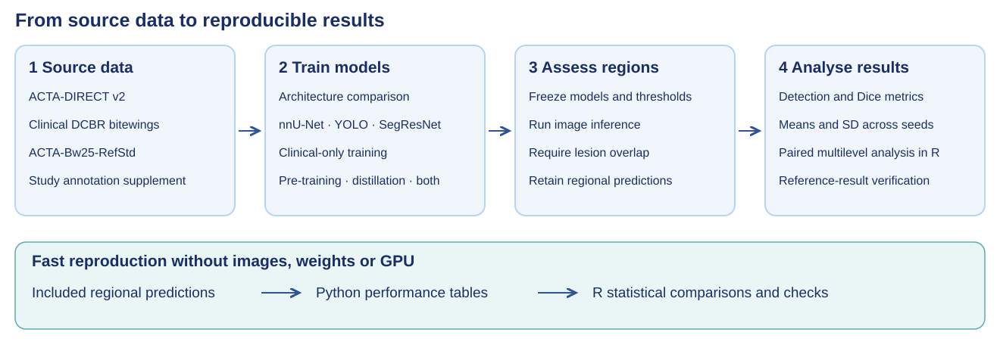

# Proximal caries laboratory transfer

Reproduction code for **Laboratory Data Under Clinical Scrutiny: Evaluating AI-Based Proximal Early Caries Lesion Detection**.

**Paper authors:** Ricardo Eugenio Gonzalez Valenzuela, Swasti Mishra, Pascal Mettes and Erwin Berkhout.

**Code orchestration and verification:** All study code was orchestrated collaboratively with **Codex from ChatGPT** and verified by **Ricardo Gonzalez**.



The study compares training on clinical bitewings alone with laboratory pre-training, teacher guidance through knowledge distillation, and their combination. This repository contains data preparation, model training, inference and assessment, performance-metric calculations, and the R analysis of regional detection accuracy.

## Quick start

Open a terminal in this folder and run:

```bash
python run.py reproduce
```

This command needs **Python 3.10 or newer**, uses only its standard library, and needs **no images, trained weights or GPU**. It recalculates the main clinical tables from the included anonymous regional predictions and verifies **544 reference means and SDs**. Results are written to `results/descriptive/`.

To reproduce the architecture-comparison summaries and the additional crop reports:

```bash
python run.py benchmark reproduce
```

To check that the released files are intact:

```bash
python run.py verify
```

The saved predictions reproduce the reported results. The training workflows generate new models and predictions; their outputs are kept in separate run folders.

Optional PNG and SVG performance plots can be generated after installing Matplotlib 3.11.2:

```bash
python tools/plot_results.py
python tools/plot_benchmark.py
```

## What is included

| Workflow | Code | Main output |
|---|---|---|
| Assemble downloaded data | `src/carieslab/datasets.py` | A checked local `data/Datasets.zip` |
| Architecture comparison | `pipelines/benchmark/` | Nine architecture/input combinations, five folds and three seeds |
| Main training strategies | `pipelines/main/` | Four strategies for each of nnU-Net and YOLO |
| Additional experiments | `pipelines/additional/` | Additional training routes and earlier implementation variants from Appendix B |
| Prediction and assessment | Each model workflow's `assess` command | Regional predictions, fixed/development-selected thresholds and per-model metrics |
| Clinical performance tables | `analysis/reproduce_descriptive.py` | Detection, segmentation, localisation and confusion-count tables |
| Statistical comparisons | `analysis/detection_accuracy.R` | Six baseline comparisons, confidence intervals and model diagnostics |

The underlying training and evaluation implementations are included locally. Running the workflows does not require access to the authors' original computer, personal folders or private code repositories.

## Data and annotation versions

Download the radiographs and original annotations from their original sources:

| Dataset | Role | Original data source |
|---|---|---|
| ACTA-DIRECT v2 | Laboratory radiographs and lesion annotations | [VU data repository](https://doi.org/10.48338/VU01-H5ALYJ) |
| Dental Caries in Bitewing Radiographs — DCBR | Clinical development images | [Mendeley Data](https://doi.org/10.17632/4fbdxs7s7w.1) |
| ACTA-Bw25-RefStd | Separate clinical assessment images and expert reference annotations | [VU data repository](https://doi.org/10.48338/VU01-UHGI3K) |

Original radiographs are **not redistributed here**. Cite the data creators and follow the terms on each source record; the [dataset citations](docs/dataset_citations.md) are collected separately. The repository supplies the study's additional Refined DCBR masks and anatomical region files separately, with attribution and a CC BY 4.0 licence, in `data/study_annotations.zip`.

**Annotation update:** the included Refined DCBR masks were updated after the reported experiments. Training with these updated masks can produce different results; the size of the difference has not been evaluated. The original radiographs, region definitions, folds and clinical assessment reference remain unchanged. The included saved predictions preserve the original results for comparison.

Put the original downloaded archives in `data/downloads/`, then assemble them:

```bash
python run.py datasets assemble
python run.py datasets inspect data/Datasets.zip
```

Nested folder names can vary. The assembler identifies the required files by checksum and copies their bytes without editing images. The current annotation release uses the `updated` inventory. The `recorded` inventory is also retained for use with the original masks. See [data preparation](docs/data.md) and [source credits and file requirements](docs/data_sources.md).

## Training

Full model training is intended for Linux with an NVIDIA GPU and a compatible PyTorch installation. The recorded hardware was an NVIDIA DGX Spark. Install the recorded training packages in a separate environment:

```bash
python -m venv .venv
source .venv/bin/activate
python -m pip install --upgrade pip
python -m pip install -r requirements/training.txt
python run.py doctor --training
python tools/capture_environment.py --out results/environment.json
```

Use the [official PyTorch installer](https://pytorch.org/get-started/locally/) if your GPU or platform needs a different wheel source. The repository records PyTorch 2.14.0 and the model-framework versions; the correct CUDA build depends on the local hardware. The recorded versions are supplied in `requirements/training.txt`; this is not a complete historical lock of every transitive dependency.

### Main strategies

First inspect the dependency graph and prepare the inputs:

```bash
python run.py main plan
python run.py main check --data-zip data/Datasets.zip --annotation-version updated
python run.py main prepare --data-zip data/Datasets.zip --annotation-version updated
```

Run all three seeds and five folds:

```bash
python run.py main train --data-zip data/Datasets.zip --annotation-version updated
```

The run trains shared teacher/pre-training models only where needed, then executes the eight main strategies. Original split assignments and native nnU-Net plans are supplied under `configs/main/`; they are reused rather than regenerated by a new planner.

For one seed–fold cell, use a separate output directory:

```bash
python run.py main train --data-zip data/Datasets.zip --annotation-version updated --seed 17 --fold 0 --output runs/main_one_cell
```

A one-cell run checks execution but does not reproduce the full study summary. The public strategy names and exact routes are described in [training](docs/training.md).

### Architecture comparison

```bash
python run.py benchmark plan
python run.py benchmark prepare --dataset-zip data/Datasets.zip --annotation-version updated
python run.py benchmark check --annotation-version updated
python run.py benchmark train --group all --annotation-version updated
```

The nine combinations comprise nnU-Net, YOLO and SegResNet, each evaluated with laboratory proximal-side region crops, clinical proximal-side region crops, or clinical bitewings. The frozen recipe list has 135 fits. Use `--group`, `--seed` and `--fold` to select a subset; `--dry-run` shows a plan without starting training.

### Additional experiments

The additional routes in Appendix B are kept separate from the eight main strategies. Their entry point and its exact arguments are available with:

```bash
python run.py additional --help
```

The additional crop reports reuse the relevant architecture-comparison models and preserve their recorded coverage; they are not treated as new training algorithms. See [the benchmark workflow](pipelines/benchmark/README.md) and [the additional workflow](pipelines/additional/README.md).

## Assessment and performance metrics

Assessment is a separate step after model selection and development thresholds have been frozen:

```bash
python run.py main assess --data-zip data/Datasets.zip --annotation-version updated
python run.py benchmark assess --annotation-version updated
python run.py benchmark report --annotation-version updated
```

For a subset, pass the same seed, fold and output arguments used during training. Changed model files or development thresholds are rejected rather than silently reused.

The evaluation unit is the **proximal-side region**. A positive region counts as correctly detected only when the predicted lesion overlaps the reference lesion. A prediction elsewhere in that positive region is an error. A negative region is correct only when it has no predicted lesion.

The supplied metric code calculates sensitivity, specificity, PPV, NPV, detection accuracy, balanced accuracy, F1, Matthews correlation coefficient, Dice-Positive, Dice-TP and pixel micro-Dice. Reference-conditioned localisation ROC area and average precision are also retained. These localisation scores use the known lesion location on positive regions and are not ordinary patient-level diagnostic classifier scores.

For the main strategies, metrics are calculated per fitted model, averaged over five folds within each seed, and summarised as the mean and sample SD across three seeds. Architecture-comparison summaries pool held-out development predictions within each seed before averaging over seeds. Undefined values are retained as undefined and their valid counts are reported.

See [assessment and metric definitions](docs/assessment.md), [the analysis scripts](analysis/README.md) and [the reference-data dictionary](data/reference/README.md).

To calculate tables and statistics from a **newly assessed** main run:

```bash
python run.py reproduce --input runs/main/reports/regional_predictions.csv.gz --out results/new_run_tables --no-reference-check
python run.py statistics --input runs/main/reports/regional_predictions.csv.gz --out results/new_run_statistics --no-reference-check
```

The explicit flag prevents a new experiment from being mistaken for a verification of the original saved results. The metric definitions and statistical procedure remain the same.

## Statistical analysis in R

Install the recorded analysis packages once:

```bash
Rscript analysis/install_packages.R
```

Then run:

```bash
python run.py statistics
```

Or run the R script directly:

```bash
Rscript analysis/detection_accuracy.R
```

The analysis uses the fixed-threshold regional overlap outcome. It fits one multilevel logistic model per architecture and compares each of its three laboratory-data approaches directly with clinical-only training. It writes the six contrasts, pointwise 95% confidence intervals, nominal P values, fitted models and convergence diagnostics to `results/statistics/`. No multiplicity adjustment is applied, consistent with the exploratory analysis.

The recorded analysis used R 4.5.1, lme4 2.0-6 and jsonlite 2.0.0. The supplied reference data need no images, weights or GPU. See [statistical methods and output files](analysis/README.md).

## Verification

The repository's CPU checks reproduce the reported clinical tables, the six statistical comparisons, and the saved architecture-comparison summaries. The source/configuration inventories and input fingerprints are also checked. These checks are distinct from retraining the full GPU experiment.

```bash
python run.py verify
python -m unittest discover -s tests -v
```

Validation results and the scope of each check are recorded under `reproducibility/`. Generated training runs, downloaded images and local model weights are ignored by Git. Trained weight files are not included; they are generated by the training commands.

## Citation and licences

Please cite the accompanying study, this code and the original datasets when using all or part of this work. The four study authors are listed above and in `CITATION.cff`.

The study code is released under **AGPL-3.0**; see [LICENSE](LICENSE). The additional study annotations carry **CC BY 4.0** attribution terms. Original datasets and third-party frameworks retain their own licences. See [third-party notices](THIRD_PARTY_NOTICES.md).
